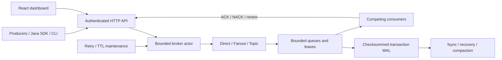

# Mini RabbitMQ

**A durable message broker built from scratch in Java.**

Mini RabbitMQ implements exchange routing, queues, deliveries, acknowledgements, retries, scheduling, and a checksummed storage protocol in project code. It is an educational, self-hosted **single-broker** system with an authenticated HTTP API, Java SDK, CLI, and live operations dashboard.

It does **not** implement AMQP, exactly-once processing, broker replication, or high availability. Full-state WAL transactions favor understandable atomicity over throughput. See [limitations](#known-limitations) before using it for real workloads.

## Features

* Direct, fanout, and topic exchanges, durable topology, binding deduplication.
* Bounded FIFO queues, competing pull consumers, prefetch, priorities 0–9.
* Binary payloads, persistent messages, all-target atomic publish admission and publisher confirms.
* Explicit ACK/NACK/reject, renewable leases, stale-token protection, redelivery.
* Fixed/exponential retry backoff with optional jitter, bounded attempts, dead letters and cycle limits.
* Durable delayed delivery and message/queue TTL.
* CRC32C WAL replay, torn-tail recovery, process storage lock, verified atomic compaction.
* Bearer-authenticated REST/metrics, YAML configuration, SLF4J/Logback logging.
* Java SDK with safe GET retries and bounded worker concurrency; Picocli CLI.
* React + TypeScript + Vite + Tailwind dashboard using real broker data.
* JUnit unit/integration/process-crash tests, benchmarks, three demo roles, Docker Compose.

## Architecture



Details: [architecture](docs/architecture.md), [routing](docs/routing.md), [persistence](docs/persistence.md), [delivery semantics](docs/delivery-semantics.md), [security](docs/security.md), [recovery runbook](docs/failure-recovery.md).

## Quick start

Requirements: JDK **25 LTS**, Maven **3.9+**. Node **24** is used for the dashboard. Tests run offline after Maven dependencies have been resolved; no external broker, datastore, or credentials are required.

```bash
mvn clean verify
export MINIRABBIT_TOKEN="$(openssl rand -hex 24)"
java -jar target/mini-rabbitmq-1.0.0.jar server start
```

PowerShell:

```powershell
mvn clean verify
$env:MINIRABBIT_TOKEN = [Convert]::ToHexString([System.Security.Cryptography.RandomNumberGenerator]::GetBytes(24))
java -jar target/mini-rabbitmq-1.0.0.jar server start
```

Keep the same token in producer/worker terminals. Default address: `http://127.0.0.1:8080`. Configure using `server start --config configs/broker.yaml`. Storage defaults to `./data`; never share it between running brokers. `configs/docker.yaml` is container-specific and binds on the container network.

The launchers are `scripts/minirabbit` and `scripts/minirabbit.ps1`; examples below use the command name `minirabbit`. On Unix run `chmod +x scripts/minirabbit` and add `scripts` to PATH. In PowerShell invoke `.\scripts\minirabbit.ps1` directly.

```bash
minirabbit exchange create orders --type topic
minirabbit queue create order-processing --durable
minirabbit bind orders order-processing 'orders.*'
minirabbit publish orders orders.created '{"id":123}'
minirabbit consume order-processing
```

## Exchange types and routing

DIRECT matches exact keys. FANOUT ignores keys. TOPIC supports `*` for one dot-separated segment and `#` for zero or more. For example, `orders.*` matches `orders.created`; `orders.#` also matches `orders.eu.created` and `orders`. The matcher uses dynamic programming, not recursive wildcard expansion. Overlapping bindings route only one copy per queue. Separate queues receive independent envelopes sharing one message UUID.

Mandatory zero-match publishes return `UNROUTABLE`. Non-mandatory zero-match publishes return `ACCEPTED` with zero targets and are discarded. All target queue limits are checked in a rollback-safe transaction; no partially accepted fanout is exposed.

## Queue architecture

Queues hold bounded actor-owned envelopes. Ready, scheduled, and unacknowledged counts are separate; total messages include all three. A global resident admission budget also limits aggregate payload and estimated envelope/header bytes. This version keeps live payloads in memory and scans queue entries to select the next eligible delivery. Persistence is for restart recovery rather than paging.

FIFO is defined by queue sequence among ready messages at equal priority. Competing consumers receive distinct active deliveries; processing completion may be out of order. Delayed messages and retries do not block later eligible work.

## Persistence and WAL

Each committed mutation appends a complete durable-state transaction frame: magic, version, transaction type, payload length, CRC32C, and UTF-8 JSON. That JSON contains queue IDs, message UUIDs, base64 payload bytes, properties, sequences, attempts, and UTC schedules. Metadata and messages commit together. [The storage format](docs/persistence.md) specifies byte offsets and recovery policy.

Only durable definitions and persistent messages in durable queues survive restart. Transient messages disappear even from durable queues; transient queues disappear entirely. `fsyncPolicy: always` forces each transaction before success. `none` sacrifices crash durability and never produces `PERSISTED` confirms.

Compaction writes a temporary snapshot, forces and replays it, then atomically replaces the old WAL and forces its directory where supported. No non-atomic replacement fallback is used. Windows directory durability has platform limitations documented in the storage design.

## Publisher confirms

| Status | Meaning |
| --- | --- |
| `PERSISTED` | Persistent message, all target queues durable, forced WAL commit complete |
| `ACCEPTED` | Accepted without the full persistence guarantee; inspect target count |
| `UNROUTABLE` | Mandatory routing found no target queue |
| HTTP error / exception | Rejected or uncertain storage outcome; never a successful persisted confirm |

Storage errors fail the broker closed. A complete record may have reached disk even when an error reached the caller. Publishing is not automatically retried; applications must handle uncertain outcomes and duplicates.

## Consumer acknowledgements and at-least-once delivery

ACK removes the exact envelope associated with a valid consumer/token. NACK/reject with `requeue=true` schedules retry; `false` dead-letters or drops it. Tokens are random, single-use, and rejected after expiration, completion, cancellation, queue deletion, or restart. An old ACK cannot remove a newer redelivery.

Durable acknowledged queues provide at-least-once processing opportunities until explicit terminal policies apply. Duplicate processing remains possible after consumer/process failure. Use message UUIDs to make application effects idempotent. No exactly-once guarantee is made.

## Visibility timeouts

Default visibility is 30 seconds. Active deadlines use monotonic time. Consumers must ACK or renew before expiry. Expired deliveries enter the retry policy and receive a new token. Disconnected consumers can cancel explicitly, or their leases/idle subscriptions expire. After broker restart, runtime leases are gone and persisted unacknowledged work can redeliver immediately.

## Retries

Queue `retry` sets `maxAttempts`, `initialDelayMs`, `maxDelayMs`, and `jitter`. Attempts include the first delivery. Delay is bounded exponential backoff; equal initial/max gives fixed delay. Retry timestamps and attempt counts persist. Retry work rejoins after ready work and can be reordered. Maximum attempts is enforced after recovery as well as normal NACK/timeout.

## Dead-letter queues

Configure a source queue's `deadLetter` with an exchange, routing key, and `maxHops`, then bind a destination queue to that exchange. Rejection, expired ready work, or exhausted attempts transfers the entry atomically. Headers preserve original routing, failure reason, attempt count, and timestamp. Self-routing is suppressed and persistent hop limits bound cross-queue cycles.

Without a matching dead-letter route, terminal work is dropped. A full destination retains source work and maintenance backs off while allowing the destination to drain. Overflow publishing is rejected rather than dead-lettered. Dashboard replay is a publish followed by an ACK; it can duplicate work if interrupted between those operations.

## Delayed delivery and TTL

Publish `delayMs` or use `publishDelayed`. UTC due times survive restart for durable persistent work; future work is never dispatched early.

Message `ttlMs` and queue `ttlMs` use the shorter nonzero value, measured from original publish time including delays/retries. Expired ready work cannot be delivered. Already active deliveries may ACK after TTL until their lease expires. Requeue/timeout after TTL terminates work. Host clock changes affect persisted wall-clock scheduling and TTL.

## Priorities

Enable `priorities` per queue. Higher integer priority (0–9) wins; equal priorities remain FIFO. Low-priority messages can starve. There is no cross-priority strict FIFO.

## Backpressure and concurrency

YAML bounds messages, approximate resident bytes, queue length, actor backlog, consumer count, prefetch, global in-flight delivery count, HTTP request concurrency, and body size. Publish overload returns 429; oversized payloads return 413. At extreme network saturation a connection can be closed before JSON is available. No unlimited message buffers or thread-per-message executor is used.

One actor serializes state and WAL transitions. HTTP virtual threads and SDK callback executors remain separate. This implementation deliberately serializes disk operations with state changes; fsync and compaction pause dispatch. Queue scans and full-state serialization limit scaling.

## Java SDK

The SDK is included in the Maven artifact under `com.minirabbit.client`.

```java
try (MiniRabbitClient client = MiniRabbitClient.connect("http://localhost:8080")) {
    client.declareExchange("orders", ExchangeType.TOPIC, true);
    client.declareQueue("order-processing", true);
    client.bind("orders", "order-processing", "orders.*");
    var confirmation = client.publish("orders", "orders.created", "{\"orderId\":123}");
    try (var worker = client.consume("order-processing", 10, 2, delivery -> {
        System.out.println(delivery.value().message().id());
        delivery.ack();
    })) {
        Thread.sleep(10_000);
    }
}
```

Imports: `com.minirabbit.client.MiniRabbitClient` and `com.minirabbit.core.Models.ExchangeType`. The default connection reads `MINIRABBIT_TOKEN`; the constructor also accepts a token explicitly. `ClientDelivery` exposes `body`, `bodyAsString`, `ack`, `nack`, `reject`, and `renew`. Worker concurrency uses separate consumer IDs. Callback exceptions trigger NACK with requeue. The SDK retries GET I/O failures up to three times and never blindly retries publish or ACK.

Use manual `poll(queue, consumerId, prefetch, waitMs)` for explicit batch control. `setPrefetch` updates a registered consumer, rejecting reductions below current unacknowledged count. Next polls must send the new value. Close workers/clients to cancel subscriptions; leases cover unclean termination.

## CLI

```text
minirabbit server start [--config configs/broker.yaml]
minirabbit exchange create orders --type topic
minirabbit exchange list
minirabbit queue create order-processing --durable
minirabbit queue list
minirabbit bind orders order-processing "orders.*"
minirabbit publish orders orders.created '{"id":123}'
minirabbit consume order-processing
minirabbit queue stats order-processing
minirabbit dlq list
minirabbit stats
minirabbit version
```

Set `MINIRABBIT_URL` or `--url http://localhost:8080`. `consume` prints and ACKs each message. `dlq list` derives candidate dead-letter destinations from configured source policies and exchange bindings. More complex queue options are available through SDK/REST.

## REST API

All `/api/v1` operations and `/metrics` require `Authorization: Bearer <token>`. JSON requests require `Content-Type: application/json`. The API uses **camelCase** fields; binary `payload` is standard base64; times and durations are integer milliseconds.

| Method | Path | Operation |
| --- | --- | --- |
| POST / GET | `/api/v1/exchanges` | Declare / list exchanges |
| DELETE | `/api/v1/exchanges/{name}` | Delete exchange/bindings |
| POST / GET | `/api/v1/queues` | Declare / list queues with statistics |
| GET / DELETE | `/api/v1/queues/{name}` | Queue statistics / delete |
| POST / GET | `/api/v1/bindings` | Bind / list |
| POST | `/api/v1/messages/publish` | Atomic routed publish |
| POST | `/api/v1/queues/{name}/consume` | Register and long-poll |
| POST | `/api/v1/deliveries/{token}/ack` | Acknowledge |
| POST | `/api/v1/deliveries/{token}/nack` | Reject/requeue |
| POST | `/api/v1/deliveries/{token}/reject` | Same explicit rejection semantics |
| POST | `/api/v1/deliveries/{token}/renew` | Renew lease |
| GET | `/api/v1/consumers` | List active subscriptions |
| DELETE / PATCH | `/api/v1/consumers/{id}` | Disconnect / set prefetch |
| GET | `/api/v1/stats` | Process counters and storage state |
| POST | `/api/v1/storage/compact` | Force verified compaction |
| GET | `/health`, `/ready` | Public liveness / readiness |
| GET | `/metrics` | Authenticated Prometheus exposition |

Examples:

```json
{"exchange":"orders","routingKey":"orders.created","payload":"aGVsbG8=","properties":{"contentType":"text/plain","persistent":true,"ttlMs":60000,"delayMs":0,"priority":0,"headers":{"source":"checkout"}},"mandatory":true}
```

Consume body: `{"consumerId":"worker-1","prefetch":10,"waitMs":1000}`. Response is one delivery, or HTTP 204 when none is available. ACK/NACK/renew body: `{"consumerId":"worker-1","requeue":false}`. Errors use `{"error":{"code":409,"message":"Stale or foreign delivery token"}}`.

## Monitoring and dashboard

Structured key/value Logback output reports lifecycle and operational failures without payloads/tokens. Prometheus metrics include published/delivered/acked/nacked/redelivered/dead-lettered totals, queue depth, unacked messages, consumers, storage bytes, recovery time, and aggregate publish/delivery latency sums. Counters reset at process restart; queue/storage state is current. There are no unbounded message-ID labels or built-in histograms.

```bash
cd dashboard
npm ci
npm run build
npm run dev
```

Open the Vite URL (usually `http://127.0.0.1:5173`) and enter the broker token. The dev proxy connects to port 8080. Overview, exchanges, queues, consumers, dead letters, and storage all read real API data. The rate chart derives publish deltas from bounded recent observations. Dead-letter inspection uses a real lease; replay can duplicate work. Storage can request compaction. There are no fabricated samples or operational values. Per-queue historical rate series are not implemented.

## Docker Compose

Copy `.env.example` to `.env` and set a random token, then:

```bash
docker compose up --build
```

Services: broker, order producer, order consumer, notification consumer, and dashboard. Open `http://127.0.0.1:3000` and enter the token. The producer exits after 100 messages; worker services continue. A named volume preserves broker data. Broker and dashboard health checks are provided. The broker and dashboard run as non-root users. The producer sends intentionally failing notifications so retry exhaustion generates dead letters.

Docker CLI is installed in the development environment, but the daemon was unavailable; container execution is **not verified**. See [verification](docs/verification.md).

## Demo walkthrough

Three runnable Java roles share safe, equivalent topology declarations:

```bash
java -cp target/mini-rabbitmq-1.0.0.jar com.minirabbit.examples.Demo order-consumer
java -cp target/mini-rabbitmq-1.0.0.jar com.minirabbit.examples.Demo notification-worker
java -cp target/mini-rabbitmq-1.0.0.jar com.minirabbit.examples.Demo producer
```

The order role uses two competing workers. Every tenth order intentionally fails notification handling, retries three attempts, and reaches `dead-letters`. Successful work is ACKed. No email credentials are required. Follow [the fault walkthrough](docs/demo.md) to exercise cancellation, restart, delay, stale tokens, and overload.

## Testing

```bash
mvn clean verify
mvn -o test                       # after dependencies are cached
mvn -Dtest=BrokerTest test
mvn -Dtest=HttpIntegrationTest,CrashRecoveryTest test
```

Tests use temporary directories and loopback HTTP. They cover routing/wildcards, ordering, priority, queue limits, all-target rollback, persistence combinations, acknowledgements, leases/redelivery, retry exhaustion, dead letters, scheduling, TTL, compaction, truncated/corrupt WAL, concurrent producers/consumers, shutdown, authentication, malformed payloads, SDK workers, and an abruptly halted child JVM. Core lease/scheduling tests use an injected clock; HTTP and child-process tests use bounded real-time waits. No test requires an external service. CI repeats the build, dashboard compilation, and executable smoke test.

## Benchmarks

```bash
java -cp target/mini-rabbitmq-1.0.0.jar com.minirabbit.bench.Benchmark 100
```

The executable measures publish, delivery+ACK, ACK-only, topic routing, raw WAL append, recovery, concurrent-producer scaling, and competing-consumer scaling. It prints JSON lines with throughput, MiB/s, p50/p95/p99 latency, errors, payload size, worker counts, and fsync policy. See [methodology and actual results](docs/benchmarks.md). These short in-process runs are diagnostic, not production capacity claims.

## Security model

Shared bearer authentication protects injection and administrative mutations. Default binding and Compose published ports are loopback-only. Bounded requests, payloads, headers, topology, queues, consumers, and delivery budgets constrain resource use. Resource names cannot become filesystem paths. WAL checksums prevent silent acceptance of corrupted data. Use TLS termination and network restrictions before remote access. There is no multi-tenant isolation or encrypted storage. [Details](docs/security.md).

## Failure recovery

Startup acquires storage ownership, replays verified complete frames, repairs a torn final append, reconstructs topology and live/scheduled entries, and reopens admission. Persistent active deliveries redeliver; durable ACK removals remain absent. Corruption stops startup. Uncertain I/O errors require restart and inspection. [Runbook](docs/failure-recovery.md).

## Known limitations

* One broker, one storage actor; no replication/failover or AMQP.
* Full-state JSON transaction frames create O(live state) work and write amplification per mutation; replay parses historical snapshots.
* Live data is memory-resident; no paging, segmented WAL, incremental indexes, or disk quotas.
* Compaction pauses dispatch and filesystem atomic-replace support is required. Windows directory-fsync limitations apply.
* Pull request admission is FIFO; consumer allocation is not strict round-robin.
* Shared token only; no per-user authorization, native TLS, encryption, or multi-tenant security.
* Wall-clock schedules/TTL depend on host time; TTL does not cancel active processing.
* Terminal policies may drop work when no dead-letter route exists; queue overflow is rejected.
* Dashboard replay is non-transactional publish+ACK; per-queue rate histories are future work.
* No publisher idempotency key or publish deduplication. Metrics counters reset after restart.
* Docker execution and interactive browser rendering were unavailable in this environment; build and API checks are recorded separately.

## Future improvements

Incremental transactional WAL records, segmented logs and disk indexes, group commit, streaming replay, fair round-robin push delivery, auth scopes/TLS, publisher deduplication, per-queue time-series metrics, long-running load/soak tests, platform power-loss testing, and replication would be separate engineering projects. They are not advertised as current guarantees.

## Engineering lessons

Atomic fanout acceptance requires persistence boundaries that cover every target. Delivery identity must include a unique attempt token rather than only a message UUID. Durable acknowledgements are as important as durable enqueue. Scheduled retries are ordinary persisted queue state, while active leases are process-local. Bounded admission and explicit uncertainty are essential to honest publisher confirms. The deliberately simple snapshot WAL makes those invariants inspectable and exposes its performance cost in real measurements.

## Repository layout

```text
src/main/java/com/minirabbit/
  core/         Models, routing, broker actor, YAML config, WAL
  server/       HTTP transport
  client/       Java SDK
  cli/          Picocli launcher
  examples/     Order producer / processor / notification roles
  bench/        Executable benchmarks
src/test/java/com/minirabbit/
dashboard/      React / TypeScript / Vite / Tailwind
configs/        Local and Docker YAML
scripts/        CLI launchers, health probe, fault walkthrough
docs/           Architecture, semantics, storage, security, verification
Dockerfile
docker-compose.yml
pom.xml
```

MIT licensed. No commits or pushes are created automatically. A [suggested commit sequence](docs/commits.md) is included.
