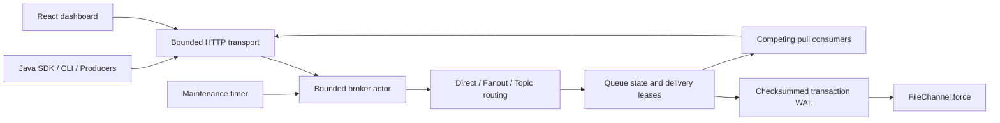

# Architecture

Mini RabbitMQ is a single-process Java 25 broker with an original queue engine. It implements HTTP/JSON, not AMQP. There is no replication, leader election, clustering, or broker high availability.

## Components and ownership

| Package | Responsibility |
| --- | --- |
| `core.Models` | Typed wire/domain records and actor-owned storage state |
| `core.Routing` | Deterministic wildcard matcher |
| `core.Broker` | Queue lifecycle, atomic routing, leases, acknowledgements, retries, scheduling, metrics |
| `core.Wal` | Framing, CRC32C, replay, storage lock, compaction |
| `server` | Authenticated REST transport and long polling |
| `client` | Java HTTP client, manual delivery methods, bounded concurrent workers |
| `cli` | Picocli entry point and operational commands |
| `examples` | Three executable demo roles |
| `bench` | Reproducible in-process benchmarks |
| `dashboard` | React/TypeScript/Vite/Tailwind management console |

One Maven artifact keeps deployment and development simple. Packages separate responsibilities; no empty modules or embedded broker libraries exist.

## Concurrency

The broker state belongs to one platform-thread actor backed by an `ArrayBlockingQueue`. Concurrent callers submit futures. FIFO task admission serializes each topology, publish, delivery, or acknowledgement operation. Queue capacity checks and multi-queue writes therefore cannot race. The actor owns WAL I/O, so there are no global locks held across disk operations and no network callbacks on its thread. It intentionally pauses dispatch during fsync and compaction; disk throughput is the principal bottleneck. A `BrokerClock` separates UTC time from monotonic deadlines and allows core time-dependent tests to advance deterministically.

Each mutation builds a candidate copy of the state. The complete durable projection is appended before the candidate becomes externally observable. Validation failures restore the old state and delivery map. I/O errors restore memory and fail the broker closed; writes with an uncertain outcome require restart and replay. Metrics affected by rolled-back dead-letter transitions are also restored.

HTTP uses a bounded pool of virtual threads, a bounded waiting queue, bounded listener backlog, and a request semaphore. Normal saturation returns HTTP 429; exhaustion before a handler starts can close the connection. Request/response/idle timeouts are set on the JDK HTTP server. Worker callbacks run in a separate fixed-size executor with at most 64 threads per SDK worker. The SDK caller controls how many worker instances it creates.

## Resource limits

Defaults bound message bytes, approximate resident message bytes, total messages, individual queue length, topology objects, bindings, actor backlog, consumers, prefetch, global in-flight deliveries, HTTP concurrency, header counts and sizes, and long-poll duration. The resident limit includes a conservative per-entry allowance and header JSON; it is an admission budget, not a JVM heap measurement. Candidate copying, JSON buffers, HTTP buffers, and object overhead require additional heap.

The default resident budget is 16 MiB, while the WAL frame limit is 64 MiB. This version keeps live messages in memory, including persistent ones. Persistence provides recovery, not disk-backed paging. Snapshot-per-transaction write amplification makes this an educational small-broker implementation rather than a high-throughput replacement for RabbitMQ.
